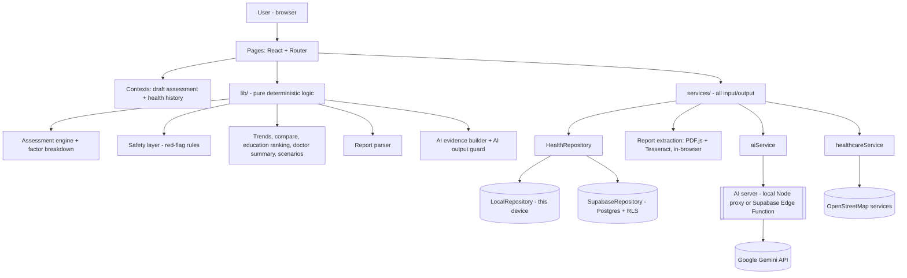
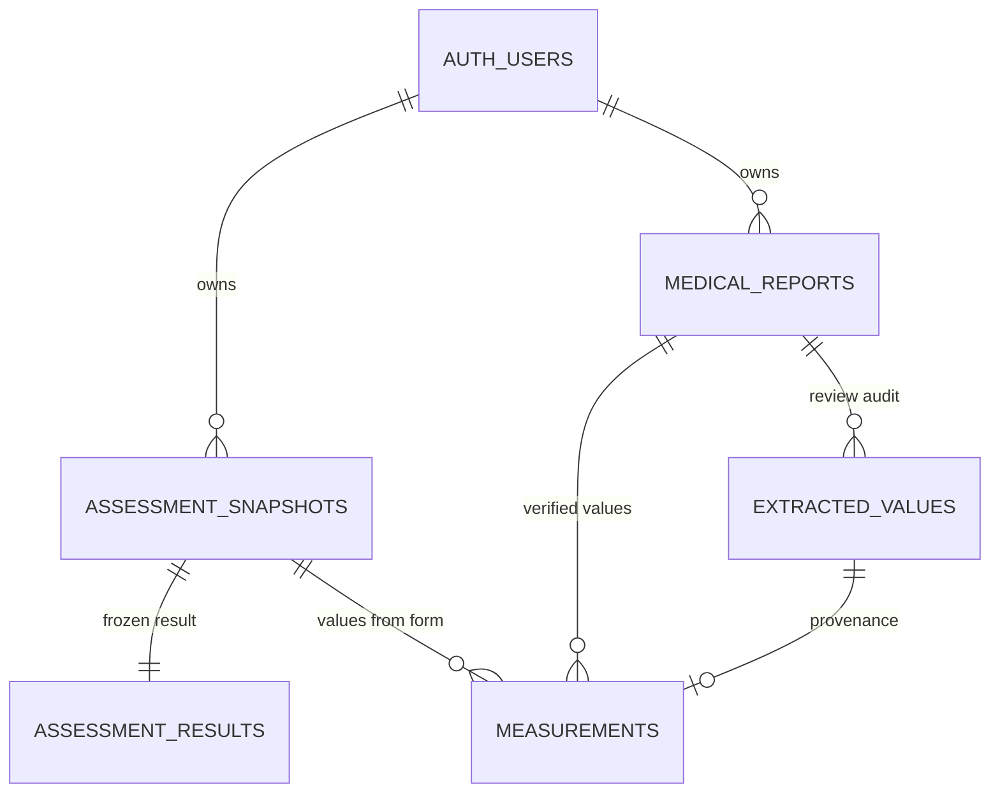

# GlucoCare - AI-Powered Personalised Diabetes Health Intelligence and Support System
### B.Tech Computer Science - Project-II Report: source material

> **How to use this file.** Every fact here comes from the actual code and the
> tests that were run. Copy sections into your report template and adapt the
> wording. Ready-to-use paragraphs are marked ✍️. Nothing is invented: there are
> **no** made-up accuracy percentages, datasets, user studies or publications.
> References marked "verify before citing" must be checked by you.
>
> Project-I material is in `docs/PROJECT-REPORT.md`. This file covers the full
> Project-II system (Project-I + all new work).

---

## Table of contents

1. Title, aim and problem statement
2. Abstract
3. Scope
4. Objectives and their status
5. Literature review
6. Research gap and contribution
7. SDG alignment
8. Technology stack
9. System architecture
10. Module design (14 modules)
11. Database design
12. Algorithms
13. Security, privacy and safety design
14. Functional and non-functional requirements
15. Implementation details
16. Testing and results
17. User interface (screens to capture)
18. Discussion: key design decisions
19. Limitations
20. Future work
21. Conclusion
22. Appendix A - how to run
23. Appendix B - glossary
24. References

---

## 1. Title, aim and problem statement

**Title:** GlucoCare - AI-Powered Personalised Diabetes Health Intelligence and Support System

**One-line description:** a web application that combines a transparent,
rule-based diabetes assessment with longitudinal health tracking, medical-report
reading, trend analysis, safety detection and a strictly controlled AI
explanation layer, while never acting as a diagnostic tool.

**Aim.** To develop a diabetes-focused health intelligence and support system
that:

- assesses user-entered health information against published reference
  criteria in a fully explainable way;
- keeps a secure, longitudinal personal health history;
- reads values from medical reports with mandatory user verification;
- detects potentially urgent situations deterministically and gives them
  priority over everything else, including AI;
- uses generative AI only to *explain* results that the deterministic system
  has already calculated, with automatic validation of every AI response;
- personalises education, prepares a doctor-ready summary and offers a safe
  educational "what-if" simulator.

✍️ **Problem statement.** People at risk of, or living with, diabetes often
have health numbers (glucose, HbA1c, blood pressure, weight) spread across lab
reports and memory, with little help in understanding what they mean or how
they have changed. Existing tools typically do only one thing: a risk score, a
glucose logbook, generic education, or a hospital locator. Tools that use
large language models (LLMs) add a new risk: the AI may invent values, imply a
diagnosis, suggest medication or falsely reassure a user who needs urgent care.
There is a need for an integrated, explainable and *safe* system in which
deterministic, auditable logic makes every health-related decision and AI is
confined to explaining those decisions in plain language.

---

## 2. Abstract

✍️ GlucoCare is a web-based, diabetes-focused health intelligence and support
system built with React, TypeScript and Supabase. Users enter demographic
details, medical history, symptoms, warning signs and measurements (blood
glucose, HbA1c, blood pressure, height and weight). A deterministic assessment
engine compares these values with published reference criteria (WHO, ADA,
ACC/AHA) and produces an educational concern indicator (Low, Moderate or High)
together with a factor-by-factor breakdown that explains exactly which input
contributed which points. An independent rule-based safety layer detects
potentially urgent situations - very high or very low glucose, very high blood
pressure, or serious warning signs - and overrides the result, displays an
emergency banner and blocks AI. Every completed assessment is stored as an
immutable snapshot in a PostgreSQL database protected by row-level security,
which enables trend charts, assessment-to-assessment comparison and a personal
"health journey" dashboard. Medical reports (PDF or images) are read inside the
browser using PDF.js and Tesseract OCR; extracted values become part of the
history only after the user confirms, edits or rejects each one. An AI layer
(Google Gemini) receives only minimal, de-identified structured evidence and
returns a plain-language explanation that is automatically checked against
that evidence; responses that change the score or level, invent numbers, imply
a diagnosis, mention medication or give false reassurance are removed or
blocked. The system also provides personalised education from a curated
library, a printable doctor consultation summary and an educational what-if
simulator that never predicts future measurements. The system was verified
with 232 unit tests, 125 end-to-end browser checks, 11 real-database
integration tests and 16 live checks against the real database and AI
provider. GlucoCare is an educational support tool and does not replace
professional medical care.

**Keywords:** diabetes, explainable assessment, clinical decision support
(educational), rule-based system, LLM safety, guardrails, OCR, personal health
record, row-level security, React, Supabase.

---

## 3. Scope

**In scope**

| Area | Detail |
|---|---|
| Condition | Diabetes-related indicators only (type 1, type 2, gestational, prediabetes ranges) |
| Inputs | Age, sex, diabetes status/type, family history, other conditions, symptoms, serious warning signs, blood glucose (+ when it was taken), HbA1c, blood pressure, height, weight, activity, smoking, diet pattern, sleep, measurement date, locality |
| Assessment | Per-indicator status vs. reference criteria, explainable point score, Low/Moderate/High educational indicator, risk factors, recommendations |
| Safety | Deterministic red-flag detection with priority over score and AI |
| History | Immutable assessment snapshots, measurement series, report records (cloud or device) |
| Insights | Trends, "what changed?", health journey dashboard |
| Reports | PDF/PNG/JPG reading (text layer + OCR) with mandatory user review |
| AI | Evidence-only explanation, validated by an output guard; optional summary overview |
| Support | Personalised education, nutrition guidance, doctor summary, what-if simulator, healthcare facility finder |

**Out of scope (deliberately)**

- Medical diagnosis, prescriptions, medication or dose advice
- Predicting future glucose, HbA1c or blood pressure values
- Non-diabetes diseases
- Emergency triage (the system only advises contacting professionals)
- Mandatory user accounts / email login (anonymous sessions are used)

---

## 4. Objectives and their status

| # | Objective | Status |
|---|---|---|
| 1 | Diabetes-focused, user-friendly web application | Done |
| 2 | Collect demographics, history, symptoms, measurements, with validation | Done |
| 3 | Explainable rule-based assessment (factor breakdown) | Done (Phase 1) |
| 4 | Deterministic safety layer with priority over score and AI | Done (Phase 2) |
| 5 | Persistent, secure, longitudinal health history (Supabase + RLS) | Done and verified on the real database (Phases 3-4) |
| 6 | Personal health journey dashboard | Done (Phase 5) |
| 7 | Trend analysis with charts | Done (Phase 6) |
| 8 | "What changed?" comparison between assessments | Done (Phase 7) |
| 9 | Medical-report extraction with user verification | Done (Phase 8) |
| 10 | Evidence-based, guarded AI explanation | Done and verified with real Gemini (Phase 9) |
| 11 | Personalised education | Done (Phase 10) |
| 12 | Doctor consultation summary | Done, incl. optional guarded AI overview (Phase 11) |
| 13 | Educational what-if simulator | Done (Phase 12) |
| 14 | Integration, accessibility, testing, security audit | Done (Phase 13), documentation in progress |
| 15 | Locality-based healthcare facility discovery | Done (from Project-I, improved) |

---

## 5. Literature review

Categories of existing work and how GlucoCare relates. Add specific papers you
have read (`[R4]`-`[R6]`).

| Existing approach | Typical capability | Limitation | GlucoCare's position |
|---|---|---|---|
| Diabetes risk-prediction tools / scores | Estimate risk from questionnaire or lab data | Single opaque score; little explanation or follow-up | Transparent point score with per-factor reasons, embedded in a full support workflow |
| Symptom checkers | Map symptoms to many possible conditions | Broad, hard to validate, can imply diagnoses | Diabetes-only scope; never names a condition |
| Diabetes management / logbook apps | Record glucose, diet, medication over time | Assume a confirmed diagnosis; little onboarding or explanation | Adds assessment, explanation, trends and education for both diagnosed and undiagnosed users |
| Personal health records (PHR) | Store a person's health data | Often generic, no interpretation | Diabetes-specific history with trends and comparison |
| Lab-report OCR / extraction systems | Read values from documents | Usually trust extracted values; standalone | Human-in-the-loop: nothing is stored until the user confirms each value |
| LLM health chatbots | Free-text conversational answers | Hallucination, diagnosis claims, unsafe advice, privacy | AI is evidence-bound, its output is validated, and it is disabled in urgent situations |
| Healthcare locators | Find nearby clinics | Not linked to a health context | Linked from results, built on open map data |

**Concepts worth citing in the review:** explainable AI (XAI) in healthcare;
human-in-the-loop data entry; LLM hallucination and guardrails (e.g. OWASP Top
10 for LLM Applications - "verify before citing"); privacy by design / data
minimisation; row-level security in multi-tenant databases.

---

## 6. Research gap and contribution

✍️ **Gap.** Existing systems rarely combine *explainable* assessment,
longitudinal history, verified report data, safety prioritisation and AI
explanation in one workflow. LLM-based health tools usually let the model
interpret raw user input, which makes their output unverifiable and
potentially unsafe.

**Contribution of this project**

1. **Deterministic-first hybrid architecture:** all medical logic (score,
   level, safety, trends, comparisons, ranking) is deterministic and testable;
   the LLM only explains the results.
2. **Evidence-grounded AI with an output guard:** the model receives a minimal
   structured evidence object, and each sentence of its reply is checked
   against that evidence (level, score, numbers, factor IDs, prohibited
   content) before display.
3. **Safety-first precedence:** a separate rule layer can force the level to
   High *without* adding points, and blocks AI completely in urgent cases.
4. **Score preservation by "characterisation testing":** the explainability
   refactor was proven not to change any score using a frozen copy of the old
   engine and 5,000 generated test cases.
5. **Human-verified report extraction:** OCR and PDF values are candidates
   only; provenance (manual / calculated / report-confirmed / report-edited /
   report-added) is stored with every measurement.
6. **Privacy-preserving persistence:** anonymous sessions, no name or locality
   in the database, immutable records, row-level security, user-controlled deletion.

---

## 7. SDG alignment

- **SDG 3 - Good Health and Well-being:** awareness, monitoring and access to
  healthcare information for a chronic condition.
- **SDG 9 - Industry, Innovation and Infrastructure:** a modern, open-standards
  health-support system built on open map data and open-source libraries.
- **SDG 10 - Reduced Inequalities (optional):** free to use, no account
  needed, works on mobile, and uses free tiers and open data.

---

## 8. Technology stack

| Layer | Technology (version) | Why it was chosen |
|---|---|---|
| UI framework | React 19.2 | Component model, large ecosystem |
| Language | TypeScript 6.0 | Type safety for medical data models |
| Build tool | Vite 8.2 | Fast dev server, code splitting |
| Styling | Tailwind CSS 4.3 | Consistent, responsive design |
| Routing | React Router 7.18 | Single-page navigation, 14 routes |
| Icons | lucide-react 1.39 | Lightweight icon set |
| Charts | Recharts 3.10 | Declarative React charts |
| PDF reading | pdfjs-dist 5.7 (Mozilla PDF.js) | In-browser PDF text extraction and page rendering |
| OCR | tesseract.js 7.0 | In-browser OCR for scans and photos |
| Database + auth | Supabase (PostgreSQL), supabase-js 2.116 | Managed Postgres, row-level security, anonymous sign-in |
| AI provider | Google Gemini API (`gemini-3.5-flash` + fallbacks); Groq, Ollama and Anthropic also supported | Free tier, JSON mode |
| AI server | Node.js 24 HTTP server (`server/ai-proxy.mjs`, no dependencies); Supabase Edge Function (Deno) for deployment | Keeps API keys server-side |
| Maps / places | OpenStreetMap: Nominatim, Photon, Overpass | Free, no API key |
| Unit tests | Vitest 5 | Fast, TypeScript-native |
| End-to-end tests | playwright-core 1.64 (drives installed Chrome/Edge) | Real browser testing |
| DB rule tests | PGlite (Postgres compiled to WebAssembly) | Run migrations + RLS tests locally |
| Linting | oxlint 1.79 | Fast linting incl. React hooks rules |

---

## 9. System architecture

### 9.1 Layered architecture



**Architectural rule:** pages never calculate or fetch directly. They call
`lib/` (pure, unit-tested functions) for logic and `services/` for I/O.

### 9.2 Conceptual pipeline

```
USER DATA -> validation -> SAFETY LAYER (rules) -> ASSESSMENT ENGINE (rules)
          -> immutable snapshot in HISTORY (Supabase)
          -> deterministic INSIGHTS: trends | what changed | education ranking | summary | scenarios
          -> AI LAYER: minimal evidence -> Gemini -> OUTPUT GUARD -> plain-language explanation
SAFETY urgent? -> banner first, level forced to High, AI never called
```

### 9.3 What is deterministic and what is AI-assisted

| Function | Deterministic (rules/code) | AI-assisted |
|---|---|---|
| Concern score and level | ✅ | ❌ never |
| Safety / red flags | ✅ | ❌ never |
| Factor reasons | ✅ | ❌ |
| Trends, comparisons | ✅ | ❌ |
| Report value extraction | ✅ parser + OCR, then **user verification** | ❌ (report is never sent to AI) |
| Education ranking and content | ✅ fixed library | ❌ |
| Doctor summary facts and questions | ✅ | Optional plain-language overview only, guarded |
| What-if simulator | ✅ | ❌ |
| Plain-language explanation | - | ✅ explanation only, guarded |

### 9.4 Deployment view

| Component | Runs on |
|---|---|
| Website | Static hosting (e.g. Vercel/Netlify), `dist/` from `npm run build` |
| Database | Supabase (PostgreSQL + Auth) |
| AI server | Local Node proxy for development; Supabase Edge Function for deployment |
| Report reading | User's browser (file never uploaded) |
| Maps | Public OpenStreetMap APIs, called from the browser |

---

## 10. Module design

### Module 1 - Assessment form and validation
- Five steps: patient information → medical history → measurements
  (+ symptoms, warning signs, glucose context) → lifestyle → date, location and report.
- Plausible-entry validation (data-entry limits, **not** medical thresholds):
  age 1-120, glucose 20-800 mg/dL, HbA1c 3-20 %, height 50-260 cm,
  weight 10-400 kg, systolic 60-260, diastolic 30-180, sleep 0-24 h.
- Live BMI; the measurement date can be today or in the past (never the future).
- The draft auto-saves on the device. Completing it creates an immutable history
  record, and a double click cannot save twice.
- Files: `src/pages/Assessment.tsx`, `src/lib/validation.ts`, `src/lib/bmi.ts`.

### Module 2 - Explainable assessment engine (`src/lib/assessmentEngine.ts`, engine v1.1.0)

Each scoring rule returns a **ScoreFactor**: factor ID, label, category,
provided?, display value, points, maximum points, severity, rule ID, reason,
citation, provenance and source fields. **Score = sum of factor points.**

| Factor | Rule (points) | Max |
|---|---|---|
| Blood glucose (mg/dL) | ≥200 → 3; 126-199 → 2; 100-125 → 1; <100 → 0 | 3 |
| HbA1c (%) | ≥6.5 → 3; 5.7-6.4 → 1; <5.7 → 0 | 3 |
| Blood pressure (needs both numbers) | systolic ≥140 or diastolic ≥90 → 2; ≥130 or ≥80 → 1; else 0 | 2 |
| BMI (from height and weight) | ≥30 → 2; 25-29.9 → 1; else 0 | 2 |
| Symptoms (count) | ≥4 → 2; 2-3 → 1; 0-1 → 0 | 2 |
| Family history | "Yes" → 1 | 1 |
| Existing diabetes | "Yes" or "Not sure" → 1 | 1 |
| Age | ≥45 → 1 | 1 |
| Physical activity | "Sedentary" → 1 | 1 |
| Smoking | current smoker → 1 | 1 |
| Diet pattern | "Often high in sugary food or drinks" → 1 | 1 |
| **Total possible** | | **18** |

**Level:** Low < 3 ≤ Moderate < 6 ≤ High. **A safety trigger forces High
without adding points**, and the result records the level the score alone
would have given (`levelBasis`).

Reference criteria: glucose fasting bands and HbA1c bands [R2], BMI WHO
categories [R1], blood pressure ACC/AHA categories [R3].

The UI section "Why am I seeing this result?" shows factors that added points,
factors considered with 0 points, and factors not provided.

### Module 3 - Safety / red-flag layer (`src/lib/safety.ts`, rules in `src/lib/redFlags.ts`)

| Rule ID | Condition | Source |
|---|---|---|
| glucose-very-high | glucose ≥ 300 mg/dL | [R2] |
| glucose-very-low | 0 < glucose < 54 mg/dL (ADA "level 2" low) | [R2] |
| bp-crisis | systolic ≥ 180 **or** diastolic ≥ 120 mmHg (either alone) | [R3] |
| warning-signs | any of 6 serious warning signs ticked (confusion, persistent vomiting, fruity breath, rapid/deep breathing, severe abdominal pain, fainting) | - |

- Evaluated **first**, independently of the score; deterministic; no AI.
- Output: level (normal/urgent), triggered rules, reasons, evidence (the
  user's own value), source fields, `aiAllowed`.
- Effects: an emergency banner at the top of the page, level forced to High,
  and the AI blocked at three points (UI, AI service, AI server). The form also
  warns immediately when a warning sign is ticked.
- The same rules are applied to values read from reports.

### Module 4 - Health history and persistence (`src/services/health/`)
- `HealthRepository` interface with two implementations:
  `SupabaseRepository` (primary, cloud) and `LocalRepository` (fallback, this device).
- No silent fallback: in cloud mode, a failed save keeps the draft and offers a retry.
- **Idempotent saves:** every draft has a stable client ID; saving twice returns
  the first record.
- **Immutable snapshots:** the stored result is never recalculated, and the
  engine version is stored with it.
- **Lazy anonymous sign-in:** visitors who only browse create no database
  user; the first save signs in once (concurrent requests share one sign-in).
- **Migration:** an assessment saved by the Project-I app can be copied into
  history, opt-in. Nothing is deleted, and name/locality are removed.
- **Deletion:** delete one assessment, delete one report, or delete all data.
- Typed error handling: storage unavailable, storage full, network, auth,
  rate-limited, invalid.

### Module 5 - My Health Journey dashboard (`/journey`)
Key statistics, the latest assessment with its main factors, latest
measurements with provenance, trends, "what changed?", the AI explanation,
personalised reading, factor summary (how often each factor contributed), a
timeline grouped by month, assessment history and the reports list. It has
loading, empty, error and populated states, and the safety banner comes first
when the latest assessment is urgent.

### Module 6 - Trend analysis (`src/lib/trends.ts`)
- 0 values → "no trend available"; 1 → "insufficient"; 2 → only "changed
  from X to Y"; 3+ → increasing / decreasing / stable / mixed.
- Direction uses only the sign of each step; **no new thresholds**.
- Glucose is analysed **separately per context** (fasting, random, after a
  meal, unknown); the fasting reference applies to fasting readings only.
- Three tiers are always kept separate: observation → possible interpretation
  (existing reference range) → fixed "not a diagnosis / not a prediction" note.
- Charts: Recharts line charts with reference-range shading, dots marking
  report-derived values, tooltips and an accessible data table.

### Module 7 - "What changed?" (`src/lib/compare.ts`)
Compares two stored assessments factor by factor: earlier and later value,
points, change (newly contributing, no longer contributing, more or fewer
points, value changed), score change, level change, safety change and
symptom changes. It flags different engine versions and never recalculates
old results.

### Module 8 - Medical report intelligence
Pipeline:

```
Upload -> type/size check -> magic-byte check (PDF/PNG/JPEG) -> PDF text layer (pdf.js)
       -> pages with < 40 characters treated as scans -> render + OCR (Tesseract)
       -> parser -> candidate values -> USER REVIEW (confirm / edit / reject, confirm date)
       -> verified measurements saved; file and raw text discarded
```

- Parameters: glucose (with fasting / post-meal / random context), HbA1c, BP
  (split into systolic and diastolic), weight, height, BMI, and the report date.
- The parser ignores reference ranges ("70 - 110"), "<"/">" limits, timings
  ("2 hr"), urine glucose and "estimated average glucose".
- Unit conversions: glucose mg/dL = mmol/L × 18.016; HbA1c % = 0.09148 ×
  mmol/mol + 2.152 (IFCC→NGSP master equation); lb → kg; m → cm.
- Confidence: high (label + unit, PDF text), medium (no unit, or OCR), low
  (implausible value).
- Statuses stored: confirmed, edited (original kept), added, rejected (number
  discarded).
- Limits: 10 MB, first 10 pages.

### Module 9 - AI explanation (AI v2)
- **Evidence builder (`src/lib/aiEvidence.ts`):** sends only the level,
  score, thresholds, factors with reasons, safety flag, changes, trend summaries
  (no dates) and context. Age is sent as a 10-year band, and only fixed-option
  answers and checklist symptoms are included. It **never** sends the name,
  locality, free text, report text or file name.
- **Prompt:** the model may only explain; it must not recalculate, diagnose,
  name medicines or doses, predict, or reassure.
- **Output guard (`src/lib/aiGuard.ts`):** a sentence is removed if it states
  a different level, states a different score, contains a number not in the
  evidence, claims a diagnosis, mentions medicine, a dose or a treatment
  change, guarantees or predicts, falsely reassures, or contradicts the
  evidence. Explanations of factors that did not contribute are dropped.
  Result: passed / sanitised (with a notice) / blocked (nothing shown). The
  reply is also blocked if the summary fails or more than 50% of it is removed.
- **AI server (`server/ai-proxy.mjs`):** API key server-side only (sent in a
  header, never logged); allowed origins; 32 KB request limit; rate limit (20
  per 10 minutes); 25 s overall budget with 12 s per model; refuses urgent
  evidence (HTTP 422); safe error messages.
- **Model resilience:** `gemini-3.5-flash`, then `gemini-3.5-flash-lite`, then
  `gemini-flash-lite-latest`, then `gemini-flash-latest`, on busy, retired or
  timed-out responses.
- The same design exists as a Supabase Edge Function for deployment (JWT
  verification on).

### Module 10 - Personalised education (`src/data/educationLibrary.ts`, `src/lib/personalize.ts`)
- A fixed library of 17 reviewed items, tagged by topic (glucose, HbA1c, BMI,
  blood pressure, nutrition, activity, smoking, monitoring, clinician,
  symptoms, family history, safety, general).
- Ranking score = Σ(points of contributing factors whose topics overlap the
  item) + 1 per rising trend on a matching topic + 100 for urgent-care content
  when safety is urgent. Ties are broken by base priority, then ID.
- Every recommendation shows "Shown because: …" quoting the user's data. The
  AI never writes education content.

### Module 11 - Doctor consultation summary (`/journey/summary`)
Deterministic sections: patient information (as entered), latest assessment,
safety flags, contributing factors, latest measurements, trends, changes since
the previous assessment, symptoms, assessment history, reports and questions
for the clinician (templates filled with the user's values). It is labelled
"User-generated health summary for discussion with a healthcare
professional", and the name is included only if the user chooses. It offers
copy-as-text and print / save as PDF. An **optional AI overview** is guarded,
clearly labelled, never changes the factual tables and is unavailable when
safety is urgent.

### Module 12 - What-if simulator (`/journey/scenarios`)
Changes only lifestyle answers (activity, diet, smoking) or a hypothetical
weight on a **copy** of the latest assessment, and re-runs the same engine.
It shows which scoring factors would change. Glucose, HbA1c and BP are locked
("kept as recorded"). It is labelled "Educational scenario - not a
prediction", has Reset, and **nothing is saved**.

### Module 13 - Healthcare facility finder (`/healthcare`)
Place lookup via Nominatim (Photon as backup); facilities (hospital, clinic,
doctor, pharmacy) within 7 km, widening to 15 km, via three Overpass servers;
one retry round with back-off when servers report "busy". It needs no API key
and credits OpenStreetMap contributors.

### Module 14 - Education and nutrition content
The diabetes basics, types, symptoms, lifestyle, when-to-get-help, food
choices, principles and snacks pages from Project-I, now with anchors and a
"Recommended for you" strip.

---

## 11. Database design (Supabase / PostgreSQL)

### 11.1 Entity relationship diagram



### 11.2 Tables (migration `supabase/migrations/0002_health_history.sql`)

| Table | Key columns | Notes |
|---|---|---|
| assessment_snapshots | id (PK), user_id (FK auth.users), client_id (unique per user), assessed_on, engine_version, input (jsonb) | A CHECK rejects input containing name, locality or report |
| assessment_results | assessment_id (PK, FK), user_id, engine_version, concern_level, concern_score, level_basis, factors, safety, result (jsonb) | 1:1 frozen engine output |
| medical_reports | id, user_id, client_id (unique), label, report_date, file_type, page_count, extraction_method, parser_version | Metadata only - no file, no text |
| extracted_values | id, report_id (FK), user_id, kind, matched_label, extracted_value, confidence, status, final_value, glucose_context | A CHECK means rejected values keep no numbers |
| measurements | id, user_id, assessment_id or report_id (exactly one), extracted_value_id, kind, value, unit, measured_on, glucose_context, source, verification | CHECKs: one parent, verification matches source, plausible value ranges |

Legacy Project-I tables (`assessments`, `results`) are left untouched; the
optional `0003_copy_legacy_rows.sql` copies them without personal fields.

### 11.3 Row-level security (RLS) and database functions

- RLS is enabled on every table. Users can **select / insert / delete only
  their own rows** (`user_id = auth.uid()`). There are **no update policies**,
  so history is immutable.
- Insert checks also require that a linked parent row (snapshot or report)
  belongs to the same user.
- The public `anon` role has no access; signed-in (including anonymous)
  users are the `authenticated` role.
- `save_assessment(p)` and `save_report(p)` save everything in one
  transaction, are idempotent on `client_id`, and run as the caller so RLS
  applies.
- `delete_my_data()` deletes all of the caller's rows (child rows cascade).

---

## 12. Algorithms

**A1 - Explainable score and level**
```
factors = [rule(input) for rule in SCORING_RULES]        # 11 rules
score   = sum(f.points for f in factors)
safety  = evaluateSafety(input)                          # independent of score
level   = "High" if safety.isUrgent else band(score)     # band: <3 Low, <6 Moderate, else High
basis   = red-flag(rules, scoreLevel=band(score)) if urgent else score(thresholds)
```

**A2 - Trend direction (n ≥ 3)**
```
steps = sign(v[i] - v[i-1]) for consecutive recorded values (1-decimal precision)
all zero -> stable; no down and last > first -> increasing;
no up and last < first -> decreasing; otherwise -> mixed
```

**A3 - Report value selection**
```
for each line containing a known label:
  skip lines about urine glucose / estimated average glucose
  value = first number after the label that is NOT part of "a - b",
          not after "<" or ">", not followed by a time unit, not after "ref/range/normal"
  unit  = text right after the value -> convert if mmol/L, mmol/mol, lb or m
  confidence = high | medium | low (plausibility, unit, OCR)
```

**A4 - AI output guard**
```
for each sentence in the AI reply:
  remove if diagnosis | medication/dose/treatment change | guarantee/prediction |
            false reassurance | wrong level | wrong score | contradicts evidence |
            any number not present in the evidence
drop factor explanations whose factorId did not contribute
blocked if summary removed or > 50% removed; sanitised if anything removed; else passed
```

**A5 - Education ranking:** see Module 10.

---

## 13. Security, privacy and safety design

| Concern | Measure |
|---|---|
| API keys | Only in the server-side `.env` / function secrets; never `VITE_`-prefixed; sent to Gemini in a header; never logged. Scanned: not in the built bundle, tracked files or git history |
| Database access | RLS on all tables, no anon access, parent-ownership checks, no updates |
| Identity | Supabase anonymous sign-in (real user IDs, no fake IDs), only on first save |
| Data minimisation | No name, locality, file name or report text stored; free text capped at 500 characters; rejected values lose their numbers |
| Report privacy | Processed in the browser; never uploaded or sent to AI |
| AI input | Whitelisted evidence only; age banded; no free text (also blocks prompt injection through text fields) |
| AI output | Guard validation; fixed disclaimer always added by the app |
| Safety priority | Rules evaluated first; banner first; AI blocked in UI, service and server |
| Deletion | Per-assessment, per-report and full deletion (cloud and device) |
| Abuse protection | Origin allowlist, rate limit, body limit, time budget |
| Duplicate writes | Client IDs + unique constraints + click guard |
| Incident handled | Real keys were found in the git-tracked `.env.example`; moved to the git-ignored `.env` before any commit; history confirmed clean |

---

## 14. Functional and non-functional requirements

**Functional - user:** complete an assessment; view an explainable result;
see safety warnings; view and delete history; view the journey, trends and
comparisons; upload and review reports; request an AI explanation; read
personalised education; generate, copy and print a doctor summary; explore
scenarios; find healthcare facilities; delete all data.

**Functional - system:** validate input; compute indicators, factors, score
and level; evaluate safety; store immutable snapshots; extract report
candidates; build evidence; validate AI output; rank education; build the
summary; run scenarios; look up places and facilities.

**Non-functional:**
- **Safety:** deterministic precedence; no diagnosis or prescription.
- **Privacy:** minimisation; RLS.
- **Reliability:** idempotency; typed errors; model fallback; retries.
- **Usability:** guided steps; plain language; loading, empty and error states.
- **Accessibility:** labels; aria-pressed, aria-current and aria-live; keyboard focus ring; data tables for charts.
- **Responsiveness:** checked at 1280, 820 and 400 px with no horizontal scrolling.
- **Performance:** charts, PDF and OCR are loaded on demand.
- **Maintainability:** typed layers; 232 unit tests.

---

## 15. Implementation details

### 15.1 Project structure (`gluco-care/`)
```
src/
  types/        data models (assessment, results, safety, health, ai, report, healthcare)
  data/         reference ranges, symptoms, nutrition, glucose context, education library
  lib/          deterministic logic: engine, safety, red flags, validation, BMI, health records,
                journey, trends, compare, report parser, AI evidence, AI guard, personalise,
                doctor summary, scenarios, format
  services/     I/O: health repositories (local + Supabase), report extraction, AI service,
                healthcare finder, Supabase client
  context/      draft assessment + health history providers
  components/   UI: results, history, journey, trends, AI, education, layout, ui
  pages/        Home, Assessment, Results, Journey, ReportUpload, DoctorSummary, Scenarios,
                Education, Nutrition, Healthcare, NotFound
server/         ai-proxy.mjs - local AI server
supabase/       migrations 0001-0003, functions/explain-results (Edge Function)
e2e/            end-to-end browser tests, live tests, mock services
```

### 15.2 Code size (approximate, excluding tests)

| Area | Files | Lines |
|---|---|---|
| src/lib (logic) | 17 | 3,357 |
| src/services | 12 | 1,640 |
| src/pages | 11 | 3,963 |
| src/components | 21 | 2,221 |
| types / data / context / hooks | 19 | 1,602 |
| server (AI proxy) | 1 | 468 |
| supabase (SQL + Edge Function) | 4 | 791 |
| e2e test framework | 13 | 1,081 |
| unit + integration tests | 21 | 2,829 |

### 15.3 Routes
`/`, `/assessment`, `/results`, `/results/:id`, `/journey`,
`/journey/summary`, `/journey/scenarios`, `/reports/new`, `/education`,
`/nutrition` (alias `/food`), `/healthcare` (alias `/hospitals`), `*` (Not Found).

### 15.4 Development methodology
Incremental, phase-by-phase development (13 phases). Each phase ended with
unit tests, type-check, lint, production build and browser testing before the
next one started. Characterisation tests locked existing behaviour before
refactoring.

---

## 16. Testing and results

### 16.1 Test strategy

| Level | Tool | What | Result |
|---|---|---|---|
| Unit | Vitest (`npm test`) | All pure logic + services with fakes | **232 / 232 pass** (20 files) |
| Score locking | Vitest | Old vs new engine on 5,000 generated cases + every threshold | Identical scores and levels |
| Database rules | PGlite (real Postgres) | Migrations, RLS across 2 users, idempotency, constraints, deletion, legacy copy | **25 / 25 pass** |
| Real database integration | Vitest (`npm run test:supabase`) | Real Supabase project, 2 anonymous users | **11 / 11 pass** |
| End-to-end | playwright-core (`npm run test:e2e`) | 8 suites, real Chrome, isolated server | **125 pass, 0 fail, 1 skipped**, 0 console errors |
| Live | `npm run test:live` | Real Supabase + real Gemini in the browser | **16 / 16 pass** |
| Static | tsc, oxlint, vite build | Types, lint, production build | Clean |

The one skipped check is the live OpenStreetMap facility search: the public
Overpass servers were overloaded during the final run. The app's outage
message was verified instead, and the search had passed in earlier runs.

### 16.2 Unit test coverage (examples)
Score locking; factor breakdown; safety thresholds on both sides of every
boundary; safety ↔ engine integration; health records; local repository
(idempotency, corruption never overwritten, quota); legacy migration; Supabase
mapping and session handling; trends (0/1/2/3+ values, contexts, no
prediction words); comparison; report parser (synthetic lab report, mmol
conversions, OCR slips, reference ranges ignored, dates, magic bytes); AI
evidence (no personal data); **AI guard adversarial tests** (score change,
level change, invented numbers and targets, diagnosis claims, medication,
dose, treatment change, guarantee, prediction, false reassurance,
contradiction, invented factor, malformed output, urgent); AI service
(blocked when urgent, errors); education ranking; doctor summary; scenarios
(no mutation, locked fields, no predictions); healthcare finder retries.

### 16.3 End-to-end suites
1. Core (19): form → result, breakdown, red-flag override, hierarchy, multiple red flags, live warning, validation.
2. History and Journey (20): independent assessments, draft reset, double click, delete, clear-all, legacy migration, corrupt data.
3. Trends and What Changed (14).
4. Medical reports (18): PDF review and save, privacy, invalid files, manual entry and safety, **real OCR** on a PNG and a scanned PDF.
5. AI explanation (9): good / sanitised / blocked / provider error / urgent / privacy.
6. Education, doctor summary, what-if (25).
7. Routes, responsiveness, accessibility (8, incl. the healthcare finder; 1 live search skipped).
8. AI proxy server (12): origins, 413, 400, 422, reshaping, provider error, timeout 504, rate limit 429.

### 16.4 Sample functional test cases (for the report table)

| ID | Test | Expected | Result |
|---|---|---|---|
| TC1 | Glucose 156 (fasting), HbA1c 6.8, BP 134/86, BMI 27.1, 3 symptoms, age 52 | Score 9/18, High; breakdown shows +3 HbA1c, +2 glucose | Pass |
| TC2 | Only a warning sign ticked, age 30 | Score 0, level High, "on points alone it would be Low", banner, AI blocked | Pass |
| TC3 | Glucose 45, BP 185/125, a warning sign | All three rules with evidence | Pass |
| TC4 | Tick and untick a warning sign on the form | Live warning appears and disappears; Continue enabled | Pass |
| TC5 | Double-click "Complete Assessment" | Exactly one record saved | Pass |
| TC6 | Three assessments over three months | Trend "increased across your 3 measurements" + chart | Pass |
| TC7 | Fasting and random glucose mixed | Analysed separately with a note | Pass |
| TC8 | Upload a synthetic lab PDF | 8 candidates, no reference-range values, date read | Pass |
| TC9 | Edit one value, reject one, save | Edited keeps original; rejected not stored; no report text stored | Pass |
| TC10 | Upload a text file renamed .pdf / 11 MB file | Rejected (magic bytes / size) | Pass |
| TC11 | Upload a PNG photo of a report | OCR reads HbA1c 7.1, glucose 132; never "high confidence" | Pass |
| TC12 | AI reply containing "Metformin…" and a fake factor | Sentence and factor removed; notice shown | Pass |
| TC13 | AI reply "You have diabetes… score is 2…" | Whole reply blocked | Pass |
| TC14 | User B queries user A's data in Supabase | Nothing returned / insert refused | Pass |
| TC15 | Browse without saving (Supabase mode) | No database user created | Pass |
| TC16 | Real Gemini explanation | Shown, passes guard, no diagnosis or medication | Pass |
| TC17 | Doctor summary copy / print | Plain text on clipboard; print shows only the sheet; PDF produced | Pass |
| TC18 | What-if: activity → moderate, weight → 70 kg | Factor changes explained; glucose/HbA1c kept; nothing saved | Pass |
| TC19 | 13 routes at 1280 / 820 / 400 px | No horizontal scrolling | Pass |
| TC20 | AI server down / invalid key / busy | Clear messages; result unaffected | Pass |

### 16.5 Defects found by testing and fixed (good for "Results/Discussion")
1. Project-I cloud sync could insert the same assessment twice (side effect inside a React state updater). The module was replaced by the idempotent repository.
2. A fast double click could save an extra assessment. Fixed with a synchronous guard.
3. The footer "Clear my data" removed only the draft and left saved history (privacy). Unified into one "delete everything" action.
4. The parser read the "2" in "(2 hr)" as a glucose value. Fixed with time-unit detection.
5. The first page load fired several anonymous sign-ups in parallel and hit Supabase's rate limit. Fixed with a shared sign-in plus lazy sign-in.
6. The configured Gemini models were retired or refused for new keys. Fixed with a new default and fallback chain.
7. A hung AI model stopped the fallback chain. Fixed with per-model timeouts.
8. Ollama timeouts were reported as "cannot reach". Fixed.
9. The healthcare finder waited 3 s unnecessarily after the final retry. Fixed.
10. The navigation did not mark old `/food` links as current. Fixed.
11. Unit tests changed behaviour when a developer `.env` existed. Isolated.
12. Real keys had been placed in a git-tracked file. Moved before any commit.

### 16.6 Results statement
✍️ No accuracy percentage is claimed, because the assessment is rule-based on
published criteria rather than a trained model. Correctness was demonstrated
by exhaustive threshold tests and equivalence with the original engine (5,000
cases). The report parser correctly extracted all 8 values from the synthetic
lab report, both from the PDF text layer and via OCR from an image and a
scanned PDF. Results on real-world reports were not measured and are listed as
future work. In live testing, real Gemini explanations passed the output guard
and contained no diagnosis or medication advice, while adversarial outputs
were removed or blocked as designed.

---

## 17. User interface - screens to capture for the report

1. Home page
2. Assessment step 3 with a warning sign ticked (live warning)
3. Results: concern card + "Why am I seeing this result?"
4. Results: red-flag case (banner + override explanation + AI blocked)
5. My Health Journey (stats, latest assessment, measurements)
6. Trend charts (HbA1c with reference shading; glucose with two contexts)
7. "What changed?" comparison table
8. Medical report review screen (confirm / edit / reject)
9. AI explanation panel ("checked against your calculated result")
10. Personalised reading ("Shown because …")
11. Doctor summary (print view)
12. What-if simulator
13. Healthcare finder results
14. Mobile view (400 px) of Results or Journey

---

## 18. Discussion - key design decisions

- **Why rule-based scoring instead of machine learning?** It is transparent,
  auditable and based on published criteria, and no labelled dataset was
  available. Every point can be explained, which a black-box model cannot offer.
- **Why is the AI not allowed to assess?** LLMs can hallucinate. Restricting
  the AI to explaining deterministic evidence, and validating its output
  against that evidence, keeps every medical statement traceable.
- **Why does safety bypass the score?** A dangerous single value or symptom
  must never be "averaged away" by a low total, so it forces High without
  changing the score, keeping the score honest.
- **Why human verification of report values?** OCR and layout parsing make
  mistakes. Storing only confirmed values protects the history, and
  provenance labels keep it transparent.
- **Why immutable snapshots?** History must show what the user saw at the
  time; corrections are made by deleting and re-entering, not by silent edits.
- **Why anonymous sessions?** They keep the app usable without a login while
  still giving every user a real identity for row-level security.
- **Why no predictions in the simulator?** No validated model links
  lifestyle changes to future glucose or HbA1c for an individual, so the
  simulator only shows how the existing rules respond.

---

## 19. Limitations

- Educational tool only; not clinically validated; no user study yet.
- Reference citations `[R1]-[R3]` are placeholders and must be replaced with verified sources.
- A glucose reading's context depends on the user's answer; the scoring uses fasting reference bands for all readings (unchanged from Project-I).
- Report parsing was verified on synthetic reports only; handwritten or complex layouts may fail; password-protected PDFs were not tested; OCR downloads its language model from a CDN on first use; English only.
- Anonymous sessions live in one browser: clearing browser data loses access to cloud history (optional email linking not implemented).
- The AI depends on an external provider's availability (mitigated by model fallback); the Supabase Edge Function version has not been deployed or run.
- Public OpenStreetMap servers can be overloaded; facility data depends on volunteer mapping.
- Deleting data removes all rows but not the anonymous auth user record (requires an admin key on the server).

---

## 20. Future work

- Clinical expert review of rules and content; usability study with real users.
- Evaluate the parser on a set of real, anonymised lab reports (precision/recall).
- Optional email sign-in to keep history across devices.
- Deploy the website and the Edge Function; add CAPTCHA for anonymous sign-ins.
- Multilingual interface and OCR (e.g. Hindi, Tamil).
- Medication reminders or device integration (glucometers) - with care to avoid treatment advice.
- Admin-side account deletion function; data export (FHIR format).
- Replace placeholder references with verified sources and add a formal literature survey.

---

## 21. Conclusion

✍️ GlucoCare Project-II turns a diabetes assessment prototype into an
integrated, explainable and safety-first health intelligence system. A
deterministic engine and an independent safety layer make every
health-related decision; immutable, privacy-preserving history enables trends,
comparisons and a personal health journey; report values enter the history
only after human verification; and generative AI is confined to explaining
verified evidence under automatic validation. The system was built in 13
tested phases and verified with unit, database, end-to-end and live tests
against the real database and AI provider. It demonstrates that LLMs can add
value to health applications when they are constrained by deterministic logic,
data minimisation and output validation, while remaining clearly
non-diagnostic.

---

## 22. Appendix A - how to run

```bash
cd gluco-care
npm install
# create .env from .env.example (Supabase URL + anon key, GEMINI_API_KEY)
npm run dev:all        # website http://localhost:5173 + AI server http://localhost:8787
npm test               # unit tests
npm run test:e2e       # end-to-end browser tests (isolated, mock AI)
npm run test:supabase  # real-database integration tests (needs .env)
npm run test:live      # real Supabase + Gemini (with dev:all running)
npm run build          # production build into dist/
```

Supabase setup: run migrations `0001` and `0002` in the SQL editor and enable
anonymous sign-ins.

---

## 23. Appendix B - glossary

- **HbA1c:** blood test reflecting average glucose over about 2-3 months (%).
- **Fasting glucose:** glucose after no food for at least 8 hours.
- **BMI:** weight (kg) / height (m)²; WHO adult categories.
- **RLS (row-level security):** database rules that restrict which rows each user can access.
- **Anonymous sign-in:** a real database user identity without email or password.
- **Idempotent:** repeating the same operation gives the same result (no duplicates).
- **OCR:** optical character recognition - reading text from images.
- **LLM:** large language model (e.g. Gemini).
- **Guardrail / output guard:** code that validates AI output before it is shown.
- **Provenance:** where a value came from (typed, calculated, report-confirmed/edited/added).

---

## 24. References

Placeholders used in the app (replace with exact, verified citations):

- `[R1]` World Health Organization - Diabetes fact sheet; WHO BMI classification.
- `[R2]` American Diabetes Association - *Standards of Care in Diabetes* (use the current year's edition, *Diabetes Care* supplement).
- `[R3]` Whelton P.K. et al., 2017 ACC/AHA Guideline for the Prevention, Detection, Evaluation, and Management of High Blood Pressure in Adults, *Hypertension* (2018). *Verify before citing.*

Suggested additional sources (**verify before citing**):

- Hoelzel W. et al., IFCC reference system for HbA1c and its relationship to NGSP, *Clinical Chemistry* (2004) - basis of the HbA1c unit conversion.
- Smith R., "An Overview of the Tesseract OCR Engine", ICDAR 2007.
- Mozilla PDF.js documentation; Tesseract.js documentation.
- Supabase documentation - Row Level Security; Anonymous Sign-Ins.
- OWASP Top 10 for Large Language Model Applications.
- Google Gemini API documentation.
- OpenStreetMap - Nominatim and Overpass API documentation.
- React, TypeScript, Vite, Tailwind CSS official documentation.
- `[R4]`/`[R5]` - peer-reviewed papers on diabetes risk assessment, diabetes self-management apps and medical-report extraction (to be chosen by you).
