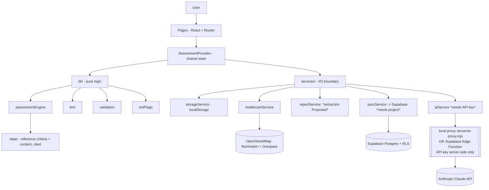
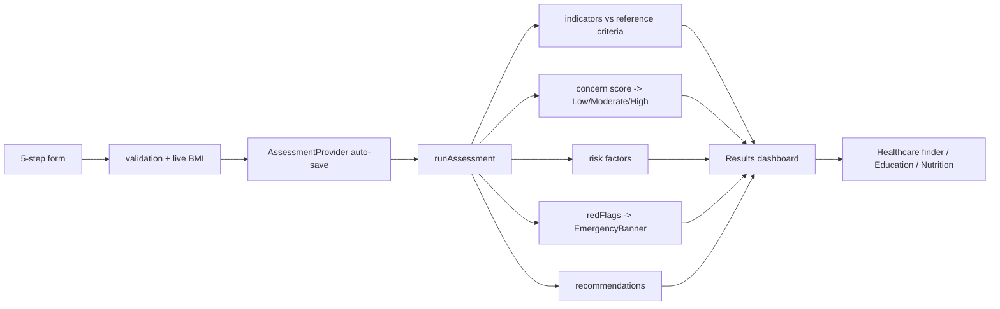

# GlucoCare - Diabetes Health Assessment and Support System
### B.Tech Computer Science - Project Report (working document)

> This document maps the **actual implementation** in this repository to the
> standard project-report sections. Nothing here is fabricated: there are no
> invented accuracy figures, datasets, publications or patents. Features that
> are designed but not connected are marked **Proposed Feature**. Citations use
> placeholders `[R1]`-`[R7]` to be replaced with verified sources.

---

## 1. Aim

To develop a web-based platform focused specifically on **diabetes** that:

- collects relevant patient information (demographics, history, symptoms, health measurements),
- presents structured, educational assessment indicators against published reference criteria,
- provides diabetes education and general lifestyle / nutrition guidance,
- helps users discover nearby healthcare facilities from their locality.

> GlucoCare brings diabetes-related assessment, education and healthcare
> resources together in one accessible platform. It is an assessment and
> **support** tool and does not replace professional medical diagnosis.

---

## 2. Scope

**In scope**

| Area | Detail |
|---|---|
| Condition | Diabetes only - type 1, type 2, gestational, prediabetes-range indicators |
| Inputs | Age, gender, diabetes/family history, symptoms, serious warning signs, blood glucose, HbA1c, blood pressure, height, weight (BMI), lifestyle (activity, smoking, diet, sleep), locality, medical report attachment |
| Outputs | Per-indicator status vs. reference criteria, an educational concern indicator (Low / Moderate / High), identified risk factors, general recommendations, an emergency-care prompt when warranted |
| Support | Diabetes education module, nutrition guidance, locality-based healthcare finder |

**Out of scope**

- Medical diagnosis, prescriptions, medication dosages
- General (non-diabetes) disease diagnosis
- Voice input (deliberately excluded)
- Emergency triage / decision-making

**Proposed Features** (designed, not connected): automatic reading of report
values, cloud database backup, AI-assisted explanation of results.

---

## 3. Abstract

Diabetes is a chronic health condition that requires continuous monitoring,
awareness and appropriate healthcare support. GlucoCare is a web-based,
diabetes-focused health assessment and support system that lets users enter
relevant demographic information, medical history, symptoms and health
measurements. The system organises these inputs and presents structured health
indicators and an educational assessment through a clean interface. It also
provides diabetes education, lifestyle and nutrition guidance, and a
locality-based healthcare-facility finder built on open map data. Planned
extensions include medical-report information extraction and AI-assisted
generation of user-friendly explanations and personalised educational
recommendations. The system is designed as an assessment and support tool and
does not replace professional medical diagnosis.

---

## 4. Literature Review

Categories of existing systems and how GlucoCare relates to each. Specific
papers are to be added as `[R4]`, `[R5]` once verified.

| Existing approach | Main capability | Limitation | Relevance to GlucoCare |
|---|---|---|---|
| Diabetes risk-prediction systems | Estimate risk from health/lifestyle data | Usually a single score; little education or care navigation | GlucoCare embeds indicators inside a broader assessment + guidance flow `[R4]` |
| Symptom-based health assessment systems | Map symptoms to possible conditions | Broad, multi-disease; hard to validate for one condition | GlucoCare narrows scope to diabetes for clearer criteria and terminology `[R1]` |
| Diabetes management / mobile apps | Log glucose, diet, medication over time | Assume a confirmed diagnosis; little onboarding assessment or local care discovery | GlucoCare adds a front-end assessment + education layer for not-yet-diagnosed users `[R5]` |
| Healthcare facility / location platforms | Locate nearby clinics and hospitals | Generic; not linked to a health context | GlucoCare connects locality search to the assessment outcome `[R7]` |
| Medical-report analysis systems | Extract values from lab reports | Standalone; results not fed into an assessment workflow | GlucoCare plans in-context report support feeding verified values into the assessment (Proposed Feature) `[R5]` |

---

## 5. Research Gap

- Existing tools tend to do **one** of: risk prediction, symptom checking,
  education, or facility discovery - rarely an integrated flow.
- General multi-disease tools become broad and difficult to validate for a
  single condition.
- Diabetes specifically benefits from combining several measurable indicators
  (glucose, HbA1c, BMI, blood pressure) with symptoms and history.
- Users often need both **health information** and **access to healthcare
  resources**, which are usually separate products.

> **Research Gap:** the need for a focused, integrated diabetes
> health-support platform that combines structured assessment, education,
> recommendations and healthcare discovery.

---

## 6. Objectives

1. Develop a user-friendly, diabetes-focused web application. **(done)**
2. Collect demographics, symptoms and relevant medical/family history. **(done)**
3. Capture measurable indicators - glucose, HbA1c, blood pressure, height/weight (BMI). **(done)**
4. Generate structured assessment indicators from predefined reference criteria. **(done)**
5. Provide diabetes education and general lifestyle / nutrition guidance. **(done)**
6. Support medical-report attachment and (Proposed) information extraction. **(attachment done)**
7. Enable locality-based discovery of nearby healthcare facilities. **(done, open map data)**
8. Explore AI-assisted explanations and personalised educational recommendations. **(implemented; disabled by default - enable with a free Gemini/Groq key or a local Ollama model, see docs/AI-SETUP.md)**

---

## 7. SDG Alignment & Expected Outcomes

**Primary:** SDG 3 - Good Health and Well-Being. GlucoCare supports health
awareness, preventive monitoring and access to healthcare-related information.

**Secondary:** SDG 9 - Industry, Innovation and Infrastructure (a modern
web-based health-support tool built on open data and open standards).

**Expected outcomes**

- A working web-based diabetes assessment prototype **(achieved)**
- Diabetes education module **(achieved)**
- Health-indicator results dashboard **(achieved)**
- Nutrition / lifestyle guidance module **(achieved)**
- Healthcare facility discovery module **(achieved)**
- Medical-report attachment support **(achieved)**; automatic extraction **(Proposed)**
- AI-assisted explanation component **(implemented; runs via a local proxy or a Supabase Edge Function once an API key is provided)**

**Possible project outcomes** (to be evaluated, not claimed):
product / prototype; conference or Scopus journal - future possibility;
patent - to be assessed for novelty; startup / product potential - future.

---

## 8. System Architecture

Layered, with a strict rule: **pages never compute or fetch directly** - they
call `lib/` for logic and `services/` for input/output.



### Assessment data flow



### Proposed extension flow

```
Medical report  ->  Edge Function extraction  ->  user verification  ->  assessment
Assessment result  ->  AI Edge Function (Claude)  ->  plain-language explanation
```

---

## 9. Functional Requirements

**User functions:** enter patient information; enter diabetes / family history;
enter symptoms and serious warning signs; enter health measurements; attach a
medical report; enter locality; view assessment results; view educational
content; view recommendations; find nearby healthcare facilities; clear their
data from the browser.

**System functions:** validate inputs (plausible-range checks); derive BMI and
per-indicator status; categorise an educational concern level; identify risk
factors; run conservative red-flag checks; store the assessment locally;
display the results dashboard; retrieve healthcare facilities from open map
data. **Proposed:** back up to a database; extract values from a report;
generate an AI explanation.

**Non-functional requirements:** usability (guided steps, clear language);
responsiveness (desktop / tablet / mobile via Tailwind); security & privacy
(local-first storage, no login, "clear my data", API keys never in the
frontend); reliability (error boundary, graceful API failure states);
maintainability (typed layers, unit-tested logic); scalability (static
frontend, optional managed backend).

---

## 10. System Modules

| # | Module | One line | Status |
|---|---|---|---|
| 1 | User & Patient Information | Collects demographics and consent-free identifiers | Done |
| 2 | Diabetes Assessment | 5-step guided form with validation and live BMI | Done |
| 3 | Health Metrics | Classifies glucose, HbA1c, BP, BMI against reference criteria | Done |
| 4 | Results & Concern | Concern indicator, risk factors, "what this means", emergency banner | Done |
| 5 | Education & Nutrition | Diabetes basics, types, symptoms; balanced-eating guidance | Done |
| 6 | Healthcare Facility | Locality -> nearby hospitals/clinics from OpenStreetMap | Done |
| 7 | Report & AI | Report attachment + AI explanation of results (server-side, key required); report value extraction | AI: implemented, off by default. Extraction: Proposed |

Data flows 1 -> 2 -> 3 -> 4, then 4 -> 5 and 4 -> 6 for follow-up. Module 7
feeds verified values back into module 2 when built.

---

## 11. Experiments & Results

The project is a **working prototype under active development**. No quantitative
model-accuracy or performance figures are reported, because the assessment
logic is rule-based against published reference criteria, not a trained model.

### Prototype validation (functional test cases)

| # | Action | Expected | Result |
|---|---|---|---|
| TC1 | Enter patient information | Values captured and persisted | Pass |
| TC2 | Enter glucose / HbA1c / BP / height / weight | Shown on the results dashboard with status vs. reference | Pass |
| TC3 | Enter an out-of-range value (e.g. age 999) | Inline validation error; "Continue" disabled | Pass |
| TC4 | Select symptoms | Symptoms appear in the results summary | Pass |
| TC5 | Tick a serious warning sign, or enter an extreme value | Red "seek medical care" banner shown | Pass |
| TC6 | Enter a locality and open the Healthcare page | Real nearby facilities listed from OpenStreetMap | Pass |
| TC7 | Attach a PDF/JPG/PNG report; attach an unsupported type | Supported types accepted; others rejected with a message | Pass |
| TC8 | Navigate between all pages; open an unknown URL | Pages load via the SPA router; unknown URL shows "Page not found" | Pass |
| TC9 | Refresh mid-assessment | In-progress answers are restored | Pass |
| TC10 | "Clear my data" | Saved assessment removed from the browser | Pass |

### Automated unit tests

`npm test` - **25 tests, all passing**, covering:

- `bmi` - calculation, string inputs, implausible values, WHO categories
- `validation` - optional-empty handling, in-range acceptance, typo rejection
- `redFlags` - very high / very low glucose, hypertensive-crisis BP, warning signs
- `assessmentEngine` - indicator classification, BMI wiring, concern escalation
  on red flags, risk-factor collection, always-present medication-safety note,
  concern label is never a diagnosis term

> Quantitative model validation and AI evaluation will be performed after the
> remaining backend / data components (Proposed Features) are implemented.

---

## 12. Conclusion & Future Work

**Conclusion.** GlucoCare is a focused diabetes health assessment and support
platform. The current prototype delivers the web interface, a validated 5-step
assessment, a rule-based engine with cited reference criteria, a results
dashboard with an emergency-care prompt, diabetes education, nutrition guidance,
and a working locality-based healthcare finder on open map data. The
architecture is layered and unit-tested, and every not-yet-connected feature is
clearly labelled in the UI.

**Future work.**

- Connect the Supabase database backup (schema and code included).
- Add verified medical / reference datasets and replace `[R#]` placeholders.
- Strengthen assessment and validation logic; add more test cases.
- Build server-side medical-report information extraction with user verification.
- Connect the AI-assisted explanation Edge Function (Claude), with its safety prompt.
- Improve personalisation of educational recommendations.
- Conduct usability testing and a broader system evaluation.
- Deploy the production build.

> From assessment to awareness and healthcare access - GlucoCare brings diabetes
> support into one platform.

---

## 13. References (placeholders - replace with verified sources)

- `[R1]` World Health Organization - Diabetes
- `[R2]` American Diabetes Association - Standards of Care in Diabetes
- `[R3]` American College of Cardiology / American Heart Association - Blood Pressure Guideline
- `[R4]` Peer-reviewed research on diabetes risk assessment (to be selected)
- `[R5]` Peer-reviewed research on diabetes management / report-analysis systems (to be selected)
- `[R6]` Official documentation - React, TypeScript, Vite, Tailwind CSS
- `[R7]` OpenStreetMap - Nominatim and Overpass API documentation
